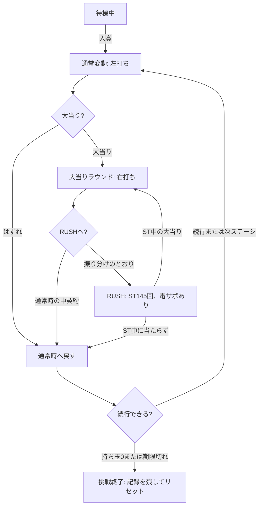

# ゲーム仕様

更新日: 2026-11-05

数値はすべてこのオリジナル台の設計案で、実機の仕様そのものではありません。
実機の参考値は機種情報サイトの掲載値で、メーカー公式では未確認です。

## 台の設定

台名は「呪契の騎士(じゅけいのきし)」で、滅びゆく王国を救うために魔女と契約した騎士の物語です。

| 要素 | 内容 |
|---|---|
| 主人公 | 騎士レオン。自分の命を代償に、呪いの力を得る |
| 魔女 | ノクス。契約を持ちかけ、演出で警告や祝福を告げる |
| 敵 | 灰の王。王国を灰に変えた存在で、最終リーチの相手 |
| 持ち玉の意味 | 契約を保つ代償。ノルマ未達か持ち玉0で契約が砕け、一からやり直す |
| 見た目 | 影絵のキャラ、赤い魔法陣、炎、灰、金属の質感 |

| ステージ | 背景 |
|---|---|
| 1〜2 | 契約の森 |
| 3〜4 | 血の礼拝堂 |
| 5〜6 | 沈んだ城 |
| 7〜8 | 灰の戦場 |
| 9〜10 | 魔女の塔 |

通常の変動中も、予告やリーチの発展で背景を切り替えます。
時間の巻き戻し、鬼の設定、リゼロ固有の言葉は使いません。

## スペック

| 項目 | 軽め(最初の設定) | 中 | 重い |
|---|---|---|---|
| 通常時の大当り確率 | 1/150 | 1/319.6 | 1/349.9 |
| 初当りまでの平均消費 | 約2,083玉 | 約4,439玉 | 約4,860玉 |
| 期待増加÷平均消費 | 約2.52倍 | 約1.18倍 | 約1.08倍 |
| ノルマの期限 | 150回 | 320回 | 350回 |

| 項目 | 値 |
|---|---|
| RUSH | ST145回、確率1/99.9、電サポあり、右打ち |
| RUSH継続率 | 1 − (1 − 1/99.9)^145 = 76.7% |
| 賞球 | ヘソ1個、電チュー4個、アタッカー15個 |
| ラウンド | 1R 10カウント、最大で10R |
| 初当り1回の平均増加 | 約5,245玉 |

**大当りの振り分け**

| 種類 | 払い出し | 実際の増加 | 通常時 | RUSH中 | 大当り後 |
|---|---|---|---|---|---|
| 大契約 | 3,000玉 | 2,800玉 | 55% | 25% | RUSH |
| 中契約 | 1,500玉 | 1,400玉 | 45% | 70% | 通常時はそのまま通常、RUSH中はRUSH |
| 小契約 | 300玉 | 280玉 | 0% | 5% | RUSH |

- 実際の増加は、払い出しからアタッカーへ打つ玉を引いた値です(1,500 − 10R×10カウント = 1,400)。
- 平均の計算は 0.45×1,400 + 0.55×(2,800 + 0.7675÷0.2325×1,694)= 約5,245玉です。
- 電サポ中の玉の増減は0として計算しました。
- 3,000玉の大当りは1,500玉を2回続けて表現します。

## 状態遷移



RUSH中は続行判定を行わず、RUSHが終わってから持ち玉と期限を判定します。

## ノルマ

全10ステージで、期限は確率の分母と同じ回転数です。目標は持ち玉の絶対値なので、大きなRUSHで複数のステージを一気に超えられます。

| ステージ | 目標の持ち玉 | 突破率(軽め) | 累計(軽め) | 累計(中) | 累計(重い) |
|---|---|---|---|---|---|
| 1 | 2,000玉 | 33% | 33.0% | 16.2% | 14.9% |
| 2 | 3,000玉 | 85% | 28.2% | 13.0% | 11.7% |
| 3 | 5,000玉 | 82% | 23.0% | 10.3% | 9.2% |
| 4 | 7,000玉 | 86% | 19.8% | 8.8% | 7.8% |
| 5 | 10,000玉 | 78% | 15.5% | 6.7% | 5.8% |
| 6 | 13,000玉 | 78% | 12.1% | 5.0% | 4.5% |
| 7 | 17,000玉 | 71% | 8.6% | 3.5% | 3.1% |
| 8 | 22,000玉 | 65% | 5.6% | 2.2% | 1.9% |
| 9 | 28,000玉 | 60% | 3.4% | 1.2% | 1.1% |
| 10 | 35,000玉 | 55% | 1.8% | 0.6% | 0.6% |

- 数値は10万回のシミュレーションです。250玉18回転、電サポ中の増減0、上記の振り分けが前提です。
- 開始時に1,000玉をもらい、追加の貸玉はありません。
- 判定は、大当りとRUSHが終わった時点の持ち玉で行います。
- 期限の回転数は通常時の変動だけ数えます。ステージ突破でリセットします。
- 持ち玉が1回転分(約13.9玉)に満たず、盤面の球と保留もなければ終了です。
- ステージ10の突破後は、期限なしで記録挑戦を続けられます。
- 記録モードは最初から期限なしで、持ち玉0になるまで打てます。
- 記録は最高持ち玉、到達ステージ、大当り回数、最大連チャン数を残します。

## 球と盤面

目標は、ハンドルの角度で球筋が変わり、発射14.9玉に1回ヘソへ入ることです。賞球1個を引いた消費は1回転あたり約13.9玉で、250玉18回転に当たります。

| 項目 | 基準 | 出典・状態 |
|---|---|---|
| 球 | 直径11mm、重さ5g | Wikipedia |
| 発射間隔 | 0.6秒に1発 | Wikipedia |
| 打ち方 | 通常時は左打ち、確変時は右打ち | Wikipedia |
| 計算間隔 | 1/240秒の固定間隔 | 案 |
| 重力 | 実物より弱い値から調整する | 案 |
| 釘との反発 | 0.6前後から調整する | 案 |
| 球の上限 | 盤面に同時50個 | 案 |

1. 左の釘の森で、球をヘソへ集める
2. ヘソは中央下で、入賞すると通常の抽選を行う
3. 右ルートの先に電チューとアタッカーを置く
4. 電サポ中は電チューが開き、玉数がほぼ減らないよう調整する
5. 大当り中はアタッカーが開き、10カウントで閉じる

10Rは最短でも100発×0.6秒 = 60秒、3,000玉は120秒かかります。RUSHのST145回は、最短0.76秒の変動なら約110秒です。

## 先バレ

先バレモードのときだけ、ヘソに入った瞬間に音と光で知らせます。設定を変えても信頼度が変わらないよう、発生率を自動計算します。

| 種類 | 音と光 | 信頼度 | 当り時の割合 | 軽め | 中 | 重い |
|---|---|---|---|---|---|---|
| 赤 | 契約の鐘+赤発光 | 40% | 78% | 1/77 | 1/164 | 1/179 |
| 白 | 契約の鐘(弱)+白発光 | 6% | 15% | 1/60 | 1/128 | 1/140 |
| 呪文声 | 鐘+呪文声+赤発光 | 大当り濃厚 | 2% | 1/7,500 | 1/15,980 | 1/17,495 |
| 発生なし | なし | - | 5% | - | - | - |

- 発光中にボタンを押すと、大当りの30%で振動します。振動すれば大当り濃厚です。
- 振動に対応しない端末では、画面と筐体を短く揺らします。
- RUSH中の先バレは赤で大当り濃厚、金で3,000玉濃厚とします。
- 音は短い金属の鐘で、実機の「ポキューン」のように音程を滑らせません。

## 予告とリーチ

抽選は、当落を決めてから演出を選ぶ順番です。発生率は次の式で決めます。

```
M = O × p / (1 − p) × (1 − T) / T
```

Mは外れ時の発生率、Oは当り時の割合、pは大当り確率、Tは信頼度の目標です。

| リーチ | 信頼度 | 当り時の割合 | 全体の発生率(軽め) | 変動時間 |
|---|---|---|---|---|
| ノーマルリーチ | 1.5% | 5% | 1/45 | 20秒 |
| 魔女SP | 15% | 25% | 1/90 | 40秒 |
| 契約SP | 35% | 40% | 1/131 | 60秒 |
| 灰の王SP | 60% | 28% | 1/321 | 80秒 |
| 全回転 | 大当り濃厚 | 2% | 1/7,500 | 15秒 |

| 保留の色 | 信頼度 | 当り時の割合 | 全体の発生率(軽め) |
|---|---|---|---|
| 青 | 10% | 8% | 1/188 |
| 緑 | 25% | 17% | 1/221 |
| 赤 | 50% | 30% | 1/250 |
| 金 | 大当り濃厚 | 5% | 1/3,000 |

| 連続予告 | 信頼度 | 当り時の割合 | 全体の発生率(軽め) |
|---|---|---|---|
| 2連 | 8% | 15% | 1/80 |
| 3連 | 25% | 25% | 1/150 |
| 4連 | 60% | 25% | 1/360 |

| 状態 | 変動時間 |
|---|---|
| 通常時・保留0〜1個 | 12秒 |
| 通常時・保留2個 | 8秒 |
| 通常時・保留3〜4個 | 4秒 |
| RUSH中のはずれ | 最短0.76秒 |

- 図柄は1〜9の3列です。保留は最大4個です。
- 赤以上の保留や4連予告で外れるときは、必ずリーチまで見せます。
- カスタムはノーマル、先バレ、先読みチャンス、メリハリ、プレミアの5種類です。
- 釘の配置、変動時間、信頼度は、遊んだ感想で調整します。

## 音

音はすべてWeb Audioで生成し、音声ファイルも無料素材も使いません。球の音は衝突の強さで音量と高さを変えます。

| 音 | 作り方 | 段階 |
|---|---|---|
| 発射 | 短いノイズとバネのような低音 | 1 |
| 釘 | 高い金属音を衝突ごとに少しずつ変える | 1 |
| 球が転がる音 | 弱いノイズを速度に合わせて鳴らす | 1 |
| 入賞 | 短い上昇音 | 1 |
| 払い出し | 球が連続して流れる金属音 | 3 |
| 図柄の停止 | 打楽器の短い音 | 3 |
| 契約の鐘 | 倍音を重ねた金属の鐘 | 4 |
| 呪文声 | 低音の声帯音を母音に似せたフィルターに通す | 4 |
| BGM | 通常、リーチ、RUSH、大当りの4曲をコードで合成 | 3〜4 |

## 受け入れ基準

| 確認対象 | 基準 | 方法 |
|---|---|---|
| ヘソ入賞率 | ハンドル最適時に発射14.9玉に1回、±10% | 物理の自動実行 |
| 大当り確率 | 3設定とも目標との差が±5%以内 | 100万回の抽選 |
| RUSH継続率 | 76.7%±1ポイント | 100万回の抽選 |
| 大当りの振り分け | 各割合が目標±1ポイント | 100万回の抽選 |
| 演出の信頼度 | 各演出が目標±3ポイント | 設定ごとの抽選 |
| ノルマ突破率 | 表の累計±1ポイント | 10万回の挑戦 |
| 動作速度 | PCで60fps、スマホで30fps | 球50個の実機確認 |
| 打ち心地 | 本人が「打っていて気持ちよい」と判断 | 遊んで確認 |
